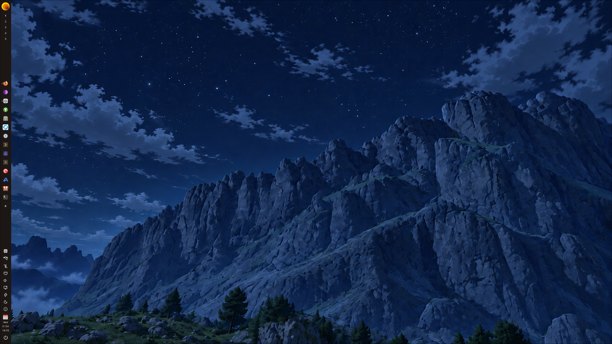
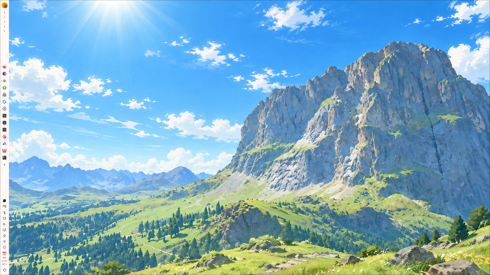
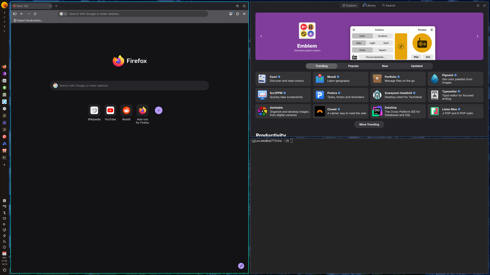

<h1 align="center">
  
</h1>

<p align="center">
  <strong>Stable v1.0.4</strong> · x86_64 · GPL-2.0-only
</p>

<p align="center">
  <a href="#install-stable">Install</a> ·
  <a href="https://github.com/vanhyprarch/vanilla-hyprarch/releases/tag/v1.0.4">Release notes</a> ·
  <a href="#documentation">Documentation</a>
</p>

Vanilla HyprArch is a **keyboard-first desktop layer for Arch Linux**.
Shortcuts offer the fastest, most efficient way to get things done. The desktop
is just as natural with a mouse: open Firefox from the dock, watch a video, or
browse your files. **Keyboard first, not keyboard only** — everyday use doesn't
require a power user's workflow.

It brings together upstream **Hyprland**, a **Quickshell** interface, and small
independent components. Arch and its upstream packages stay vanilla; the project
provides the configuration and integration that connect them.

## In pictures

<table>
  <tr>
    <th align="center">Dark appearance</th>
    <th align="center">Light appearance</th>
  </tr>
  <tr>
    <td width="50%"><a href="docs/assets/screenshots/desktop-dark.png"></a></td>
    <td width="50%"><a href="docs/assets/screenshots/desktop-light.png"></a></td>
  </tr>
</table>

<p align="center">
  <a href="docs/assets/screenshots/desktop-tiling.png"></a>
  <br>
  <sub>Firefox, an app catalog, and a terminal — tiled by Hyprland.</sub>
</p>

## Your desktop, at a glance

| Area | What you get |
| :--- | :--- |
| **Desktop** | A dock on each display, app launchers, workspaces, system tray, and clock. |
| **Everyday controls** | Audio, Wi-Fi, Bluetooth, monitor brightness, Caffeine, and Power & Idle. |
| **Appearance** | Coordinated light and dark themes, remembered wallpapers, and eight bundled 4K backgrounds. |
| **Apps & updates** | A keyboard-and-mouse app menu, package installation and removal, Flatpak with Flathub, and signed Vanilla updates. |
| **Shortcuts** | **Super+Space** for apps and actions; **Print Screen** for region, window, or monitor capture. |

Add optional components from **Additional system components**:

- **[Local Dictation](docs/dictation.md)** — hold **F9** to record, then release to
  transcribe locally. Choose your speech model, languages, and CPU or Vulkan GPU backend.
- **[Zig Screensaver](https://github.com/vanhyprarch/vanhyprarch-zig-player)** — an
  independent native player with Color Mix, Matrix, Doom, and Game of Life effects.

## Install stable

Start with a **fresh, minimal Arch Linux x86_64 installation**, working Internet,
and a regular user with `sudo` access. Configure the base system and graphics
drivers for your hardware first; the Archinstall entry point is still planned.

**v1.0.4 downloads:**
[Release archive](https://vanhyprarch.it/dist/v1/vanilla-hyprarch/releases/v1.0.4/assets/vanhyprarch-v1.0.4.tar.gz) ·
[Release metadata](https://vanhyprarch.it/dist/v1/vanilla-hyprarch/releases/v1.0.4/assets/release.json) ·
[GitHub release](https://github.com/vanhyprarch/vanilla-hyprarch/releases/tag/v1.0.4)

The direct downloads use the project's ServerPlan mirror. Some anonymous GitHub
requests currently return HTTP 404; those responses do not indicate a missing release.

<details>
<summary><strong>Verified installation commands</strong></summary>

Run as your regular user. Confirm the pinned SHA-256 values below against a
trusted publisher record before executing downloaded code.

```bash
(
  set -e
  sudo pacman -Syu --needed curl
  bundle_dir=$(mktemp -d "$HOME/vanhyprarch-v1.0.4.XXXXXXXX")
  cd "$bundle_dir"
  download_base='https://vanhyprarch.it/dist/v1/vanilla-hyprarch/releases/v1.0.4/assets'

  curl -fL --proto '=https' --proto-redir '=https' --tlsv1.2 \
    -o release.json "$download_base/release.json"
  curl -fL --proto '=https' --proto-redir '=https' --tlsv1.2 \
    -o vanhyprarch-v1.0.4.tar.gz "$download_base/vanhyprarch-v1.0.4.tar.gz"

  sha256sum -c <<'SHA256'
b41625ed6fbb1e8c215539111b30ab7bcbef29e8ba14d921b0a0e252ce60a11a  release.json
dc6dd35cf6f23361d9b1e51b909130e8779669a8f90ee5275bde99a0766e121e  vanhyprarch-v1.0.4.tar.gz
SHA256

  tar -xzf vanhyprarch-v1.0.4.tar.gz
  "$PWD/vanhyprarch-v1.0.4/install.sh" \
    --release-metadata "$PWD/release.json" \
    --release-artifact "$PWD/vanhyprarch-v1.0.4.tar.gz"
)
```

The installer verifies the bundle again, validates the installation, and records
its stable release identity. Reboot afterward to enter the SDDM login.
See the [installation strategy](docs/installation-strategy.md) for the full workflow.

</details>

## Already using Vanilla HyprArch?

Open **Update** from the dock or **Super+Space**. The updater authenticates signed
release metadata and checks the selected release before applying it.

> **Original v1.0.0 installations:** follow the
> [one-time updater preparation and upgrade guide](docs/upgrade-v1.0.0-to-v1.0.1.md)
> before your first update. Already prepared systems must not repeat the bridge.

## Documentation

| Topic | Read more |
| :--- | :--- |
| **Installation & customization** | [Installation strategy](docs/installation-strategy.md) · [File ownership](docs/deployment-ownership.md) |
| **Design & hardware coverage** | [Architecture decisions](docs/decisions.md) · [Compatibility](docs/compatibility.md) |
| **Optional components** | [Local Dictation](docs/dictation.md) · [Screensaver lifecycle](docs/screensaver-lifecycle.md) |
| **Development & releases** | [Contributor instructions](AGENTS.md) · [Release workflow](docs/release-workflow.md) · [Release contracts](docs/release-engineering.md) |

Development installs from `main` follow a separate
[source-install workflow](docs/installation-strategy.md#public-development-bootstrap)
and do not carry an installed stable release identity.

## License

Project-authored material is licensed under **[GPL-2.0-only](LICENSE)**.
Third-party material retains its own license and attribution notices.
